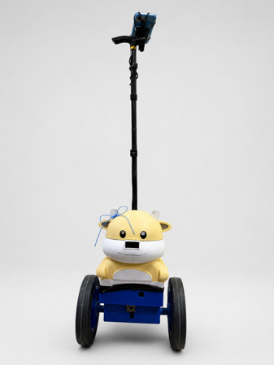
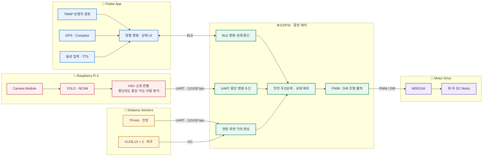
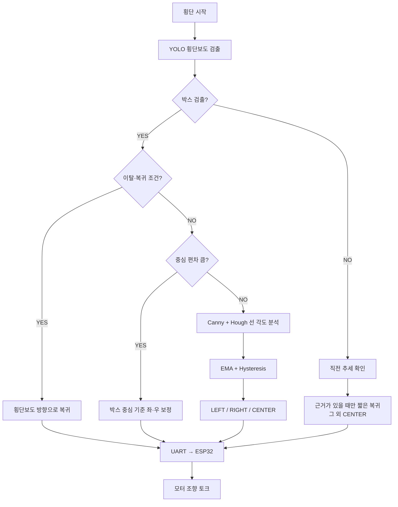
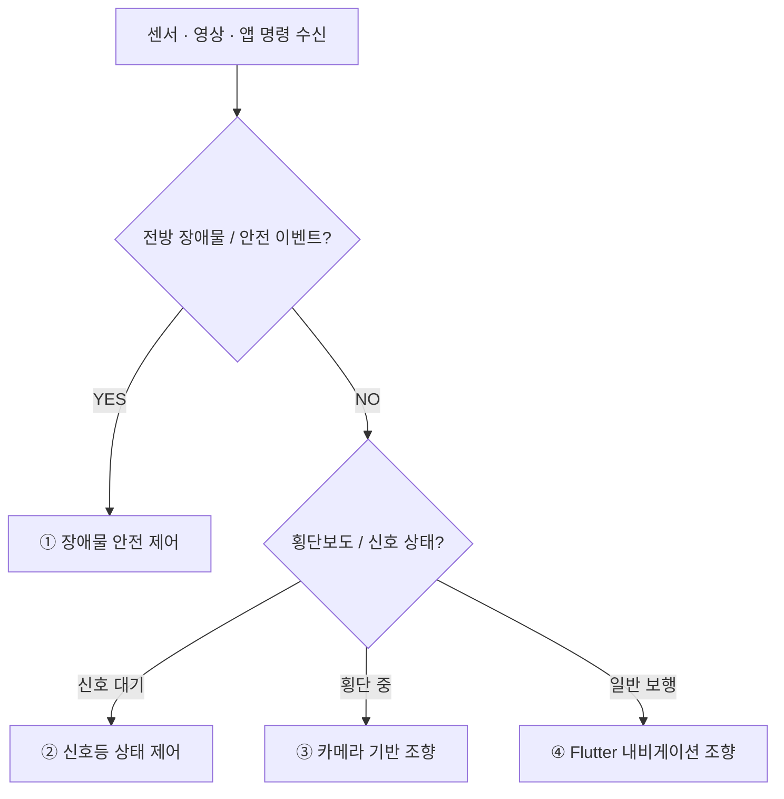

<div align="center">

# 🦯 NAVIS

### AI 기반 시각장애인 반자율 보행 보조 시스템

**“길을 알려주는 것을 넘어, 안전한 방향으로 직접 유도하다.”**

**AI Vision · Pedestrian Navigation · Sensor Fusion · Motor Steering**



[](./flutter_app/)
[](./raspberry_pi/)
[](./esp32/)


**[🎬 시연 영상 보기](https://youtu.be/FR7wWThx7Qo)** · **[📱 Flutter](./flutter_app/)** · **[🍓 Raspberry Pi](./raspberry_pi/)** · **[⚙️ ESP32](./esp32/)**

</div>

---

## ✨ NAVIS 한눈에 보기

> **사용자가 전진하고, NAVIS가 방향을 유도합니다.** 카메라·거리 센서·보행자 내비게이션 정보를 종합하여 좌·우 모터의 **조향 토크**로 방향을 전달하는 반자율 보행 보조 프로토타입입니다.

| 🧭 일반 보행 | 🚦 횡단보도 | 🛡️ 장애물 대응 |
|:---:|:---:|:---:|
| **TMAP + GPS + Compass** | **YOLO + HSV + 영상 기하 분석** | **TFmini + 모터 피드백** |
| 목적지 경로와 방향 오차를 계산해 조향 | 신호 판단부터 횡단 중 중앙 정렬·이탈 복귀까지 | 전방 장애물 감지 시 역토크로 경고 |

### 핵심 차별점

- **알림에서 조향으로:** 음성·진동 안내에 그치지 않고 **모터 조향 토크**로 방향을 전달
- **횡단 중 연속 보정:** 횡단보도 **중앙 위치 + 줄무늬 각도**를 분석해 좌·우 조향
- **이탈·소실 대응:** 횡단보도 검출 폭과 위치 변화로 이탈을 판단하고, 검출이 끊기면 **짧고 제한적인 복귀** 수행
- **국내 보행 환경 고려:** 일반 신호등뿐 아니라 **바닥 신호등**을 인식 대상으로 포함
- **제어 우선순위:** 장애물 안전 제어를 일반 길안내보다 우선 처리

---

## 🧩 System Architecture

아래 구조도는 **장치별 역할과 실제 통신 연결**을 나타냅니다.



| 구성 요소 | 핵심 역할 | 연결 |
|---|---|---|
| **Flutter App** | 목적지 검색, 경로 안내, 방위각 계산, 음성·상태 UI | ESP32 ↔ **BLE** |
| **Raspberry Pi 4** | YOLO 객체 인식, 신호등 색상 판별, 횡단 중 조향 방향 계산 | ESP32 → **UART** |
| **ESP32** | 센서 수집, 모드·우선순위 판단, 모터 토크 출력 | BLE / UART / I2C / PWM |
| **TFmini · VL53L1X** | 전방·좌우 거리 측정 | UART / I2C |
| **MDD10A · DC Motors** | 좌·우 조향 토크 발생 | PWM / DIR |

---

## 🎯 Main Features

### 01 · 목적지 기반 보행 안내


- 사용자는 앱에서 목적지를 설정하고 보행자 경로를 안내받습니다.
- **현재 진행 방향과 목표 방향의 차이**를 이용해 좌·우 조향 명령을 생성합니다.
- **전진은 사용자**, 방향 안내는 모터의 **짧은 조향 펄스**가 담당합니다.

### 02 · AI 횡단보도 및 신호등 인식

| 인식 대상 | 실제 활용 |
|---|---|
| **Crosswalk** | 횡단보도 접근 감지, 중앙·폭·각도 분석 |
| **Traffic Light** | 보행 신호등 영역 탐지 및 RED/GREEN 판별 |
| **Ground Light** | 국내 보행 환경의 바닥 신호등 인식 |
| **Tactile Paving / Stairs** | 보행 환경 객체 인식 모델의 대상 |

**신호 판별:** `YOLO 검출 → ROI 추출 → HSV 색상 점수 → 연속 프레임 안정화 → 신호 상태 확정`

> **안전 조건:** 빨간불을 확인하지 못한 상태에서 초록불을 처음 인식하면, 남은 시간을 알 수 없으므로 `LIGHT:GREEN_WAIT`로 처리해 다음 신호를 기다립니다.

### 03 · 횡단 중 방향 보정 **(핵심 기능)**



**중앙 정렬과 각도 보정은 별개로 동작합니다.** 횡단보도가 화면 중심에서 크게 벗어나면 **중앙 복귀를 우선**하고, 중심이 안정적이면 줄무늬의 방향을 분석합니다. 흰색 엣지와 **노란색 HSV 엣지**를 결합하여 줄무늬 각도를 추정합니다.

| 영상 기반 판단 | 조건 및 동작 |
|---|---|
| **중앙 정렬** | 중심 편차 진입 **12%**, 해제 **6%** |
| **각도 보정** | 각도 진입 **3°**, 해제 **2°** · EMA 필터 |
| **이탈 감지 활성화** | 횡단보도 박스 폭 **60% 이상, 연속 2프레임** |
| **이탈 복귀** | 박스 폭 **35% 이하** + 좌우 편차 확인 **2프레임** |
| **복귀 해제** | 박스 폭 **50% 이상** 또는 중앙 복귀 조건 확인 |
| **검출 소실 복귀** | 직전 폭 감소·한쪽 이동 추세가 있을 때만 **최대 0.6초 또는 2프레임** |
| **횡단 종료 판단** | **20개 추론 프레임** 연속 미검출 → `CROSSING_END` 약 **0.5초** 유지 |

> 위 프레임 수는 카메라 FPS가 아니라 **실제 AI 추론 결과의 개수**입니다. 검출이 끊겼다고 임의의 방향으로 계속 조향하지 않도록 복귀 시간과 횟수를 제한합니다.

### 04 · 전방 장애물 감지 및 촉각 경고


- 장애물이 가까워지면 **모터 역토크 3회**로 위험을 전달합니다.
- 장애물 감지·해제에는 **서로 다른 거리 기준(히스테리시스)**을 사용합니다.
- 앱에서는 전방 거리 및 장애물 상태를 확인할 수 있습니다.

**주의:** 장애물 감지 거리, 복귀 거리 등 최종 임계값은 배포한 ESP32 펌웨어 버전을 기준으로 확인해야 합니다.

---

## 🛡️ Control Priority



횡단 중에는 일반 GPS 조향보다 **Raspberry Pi의 횡단보도 보정 명령**을 우선합니다. Raspberry Pi는 횡단 중 조향 명령을 **0.3초 간격으로 재전송**하며, ESP32는 오래된 횡단 조향 명령이 유지되지 않도록 수신 시간 제한을 적용합니다.

---

## 📡 Communication Protocol

| 방향 | 주요 메시지 | 의미 |
|---|---|---|
| **Flutter → ESP32** | `L:<angle>` / `R:<angle>` | 좌·우 방향 유도 |
| | `F:<value>` / `S:0` / `B:<bearing>` | 직진·정지·목표 방위각 |
| **Pi → ESP32** | `CROSSWALK:1/0` | 횡단보도 감지 여부 |
| | `LIGHT:RED/GREEN/GREEN_WAIT` | 신호 상태 |
| | `CROSSING_START` / `CROSSING_END` | 횡단 시작·종료 |
| | `CROSS_MOTOR:L/R/CENTER` | 횡단 중 조향 방향 |
| **ESP32 → Flutter** | `DIST:<cm>` / `SIDE:<left>,<right>` | 거리 센서 값 |
| | `OBSTACLE:<cm>` / `OBSTACLE_CLEAR` | 장애물 경고·해제 |
| | `AVOID:L/R/BLOCKED` | 장애물 회피 상태 |
| | `MOTOR:L/R/STOP` | 모터 상태 |

- **BLE 장치명:** `SMART_CANE`
- **UART 통신 속도:** `115200 bps`
- 상세 구현은 [`esp32/README.md`](./esp32/README.md), [`raspberry_pi/README.md`](./raspberry_pi/README.md), [`flutter_app/README.md`](./flutter_app/README.md) 참고

---

## 🧰 Hardware & Tech Stack

### Hardware

| 구분 | 부품 | 용도 |
|---|---|---|
| Vision | Raspberry Pi 4 + Camera Module | AI 영상 추론 |
| Control | ESP32 | 센서·통신·모터 제어 |
| Distance | TFmini + VL53L1X × 2 | 전방·측면 거리 측정 |
| Actuation | MDD10A + DC Motor × 2 | 좌·우 조향 토크 |
| Interface | Smartphone | 목적지 입력·상태 확인 |
| Power | Battery | 시스템 전원 공급 |

### Software

| 영역 | 기술 |
|---|---|
| **AI / Vision** | Python · Ultralytics YOLO · NCNN · OpenCV · NumPy |
| **Navigation / App** | Flutter · Dart · TMAP · OpenStreetMap · GPS · Compass |
| **Embedded** | ESP32 · Arduino C++ · PWM · UART · I2C · BLE |
| **Development** | VS Code · Arduino IDE · Git · GitHub |

---

## 📁 Repository Structure

```text
NAVIS/
├── docs/
│   └── hardware.png
├── esp32/
│   ├── navis_esp32.ino
│   └── README.md
├── raspberry_pi/
│   ├── best3_ncnn_model/
│   ├── main.py
│   └── README.md
├── flutter_app/
│   ├── lib/main.dart
│   ├── android/
│   ├── ios/
│   ├── pubspec.yaml
│   └── README.md
└── README.md
```

### 실행 안내

| 시스템 | 실행 방법 |
|---|---|
| **Raspberry Pi** | `cd raspberry_pi && python3 main.py` · Picamera2, OpenCV, NumPy, Ultralytics, PySerial 및 NCNN 모델 필요 |
| **ESP32** | Arduino IDE에서 `esp32/navis_esp32.ino` 업로드 · 보드 및 포트 설정 |
| **Flutter** | `cd flutter_app && flutter pub get` 후 아래 명령 실행 |

```bash
flutter run --dart-define=TMAP_APP_KEY=YOUR_TMAP_APP_KEY
```

> Raspberry Pi의 모델 경로(`best3_ncnn_model`)와 UART 포트(`/dev/ttyS0`)는 실제 연결 환경에 맞춰 확인해야 합니다. TMAP API 키는 저장소에 직접 포함하지 않습니다.

---

## 🎬 Demo Video

<div align="center">

[](https://youtu.be/FR7wWThx7Qo)

**[▶ NAVIS 시연 영상 재생](https://youtu.be/FR7wWThx7Qo)**

</div>

**시연 포인트:** `목적지 안내` · `횡단보도 및 바닥 신호등 인식` · `횡단 중 중앙·각도 보정` · `이탈 복귀` · `장애물 역토크 경고`

---

## 👥 Team Members

| 팀원 | 담당 역할 |
|---|---|
| **조혜은 (팀장)** | 프로젝트 총괄, ESP32 펌웨어, 모터 제어 알고리즘, 회로 설계·HW 제작 |
| **조성원** | Raspberry Pi AI 영상처리, YOLO 모델 학습 및 객체 인식 |
| **이소이** | 거리 센서 제어·연동, Flutter App 기능 및 UI |
| **한채원** | 3D 모델링·프린팅, 회로 설계, HW·하네스 제작 |

---

## 🏆 Embedded Software Contest

**NAVIS — AI-based Semi-Autonomous Walking Assistance System**

본 프로젝트는 임베디드 소프트웨어 경진대회 출품을 위해 개발되었습니다.

> **안전 안내:** NAVIS는 연구·시연용 프로토타입입니다. 영상 인식과 센서 판단만으로 실제 도로 횡단의 안전을 보장하지 않으며, 시연은 통제된 환경에서 안전관리자 감독하에 수행해야 합니다.
