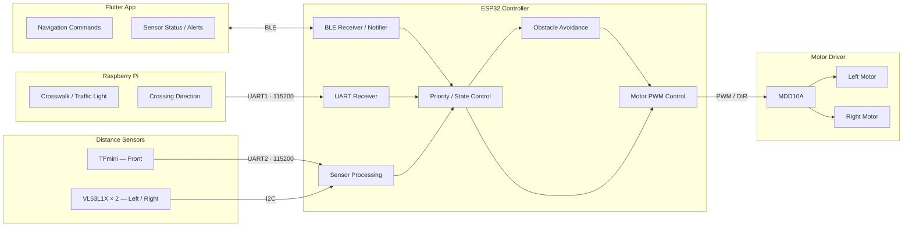

# Smart Cane — ESP32

스마트 지팡이의 **센서 데이터 처리, 모터 제어, 장치 간 통신**을 담당하는 ESP32 펌웨어입니다.

Flutter 앱에서 **BLE**로 방향 명령을 받고, Raspberry Pi에서 **UART**로 횡단보도·신호등 인식 결과를 받습니다. TFmini 및 VL53L1X 거리 센서의 측정값을 이용해 장애물 경고와 회피 유도를 수행합니다.

## 1. System Architecture



## 2. Main Features

| 기능 | 동작 |
|---|---|
| **BLE 통신** | Flutter 앱과 방향 명령 및 센서 정보 송수신 |
| **방향 유도** | L/R 명령에 따라 한쪽 모터를 짧게 구동; F는 모터 정지 |
| **전방 장애물 감지** | TFmini로 전방 거리 측정 |
| **장애물 경고** | 40cm 이하 3회 연속 감지 시 역토크 3회 |
| **장애물 회피** | 좌우 VL53L1X 거리 비교 후 회피 방향 결정 및 펄스 유도 |
| **횡단보도 제어** | Raspberry Pi의 횡단보도·신호등 인식 결과 처리 |
| **횡단 방향 보정** | Raspberry Pi의 L/R/CENTER 명령에 따라 단발 펄스 제어 |

**제어 우선순위:** 장애물 회피 > 횡단보도 제어 > 일반 길 안내

## 3. Pin Configuration

| 장치 | 신호 | ESP32 GPIO |
|---|---|---|
| MDD10A | M1 DIR / PWM | 25 / 27 |
| MDD10A | M2 DIR / PWM | 32 / 14 |
| TFmini | ESP32 RX / TX | 16 / 17 |
| VL53L1X | SDA / SCL | 21 / 22 |
| VL53L1X LEFT | XSHUT | 23 |
| VL53L1X RIGHT | XSHUT | 26 |
| Raspberry Pi | ESP32 RX / TX | 18 / 19 |

- VL53L1X 주소: **LEFT `0x30`**, **RIGHT `0x31`**
- UART: **115200 baud**
- 모터 PWM: **5 kHz / 8-bit**

> UART 연결 시 장치 간 TX/RX를 교차 연결하고 GND를 공통으로 연결해야 합니다.

## 4. Communication Protocol

### Flutter → ESP32 (BLE)

| 명령 | 설명 |
|---|---|
| `L:45` | 왼쪽 방향 유도 |
| `R:45` | 오른쪽 방향 유도 |
| `F:0` | 직진 / 모터 정지 |
| `S:0` | 모터 정지 |
| `B:135` | 목표 방위각 수신(로그용) |

### Raspberry Pi → ESP32 (UART)

| 명령 | 설명 |
|---|---|
| `CROSSWALK:1` / `CROSSWALK:0` | 횡단보도 모드 시작 / 종료 |
| `LIGHT:RED` | 빨간불 전환 시 역토크 2회 |
| `LIGHT:GREEN` | 초록불 상태 |
| `LIGHT:GREEN_WAIT` | 다음 신호 대기 |
| `CROSSING_START` / `CROSSING_END` | 횡단 시작 / 종료 |
| `CROSS_MOTOR:L` / `CROSS_MOTOR:R` | 횡단 방향 보정 |
| `CROSS_MOTOR:CENTER` | 횡단 방향 보정 정지 |

UART 메시지는 `\n`으로 구분합니다.

### ESP32 → Flutter (BLE Notify)

| 메시지 | 설명 |
|---|---|
| `DIST:80` | 전방 거리(cm) |
| `SIDE:80,120` | 좌/우 거리(cm) |
| `OBSTACLE:35` | 장애물 확정 |
| `OBSTACLE_BRAKE` | 장애물 역토크 경고 |
| `OBSTACLE_CLEAR` | 장애물 상태 해제 |
| `AVOID:L` / `AVOID:R` | 회피 방향 |
| `AVOID:BLOCKED` | 회피 불가능 |
| `MOTOR:L` / `MOTOR:R` / `MOTOR:STOP` | 모터 상태 |

## 5. Key Parameters

| 항목 | 설정값 |
|---|---|
| 장애물 확정 | **40cm 이하 × 3회** |
| 장애물 해제 | **50cm 이상** |
| 좌우 차단 기준 | **30cm 미만** |
| 방향 비교 여유 | **20cm** |
| 일반 방향 유도 | PWM 100 / 250ms |
| 회피 유도 | PWM 120 / 400ms, 900ms 간격, 최대 8회 |
| 장애물 역토크 | PWM 100 / 3회 |
| 빨간불 역토크 | PWM 100 / 2회 |
| 횡단 방향 보정 | PWM 110 / 램프업 후 최대 300ms |
| Raspberry Pi 통신 타임아웃 | 1000ms |

## 6. Dependencies

- **ESP32 Arduino Core 3.x**
- **Pololu VL53L1X Library**
- **ESP32 BLE / Wire 라이브러리**

```cpp
#include <BLEDevice.h>
#include <BLEServer.h>
#include <BLEUtils.h>
#include <BLE2902.h>
#include <Wire.h>
#include <VL53L1X.h>
```

> **참고:** 모터 제어 및 장애물 회피는 보행 보조 기능이며, 실제 사용 전 충분한 안전 검증이 필요합니다.
