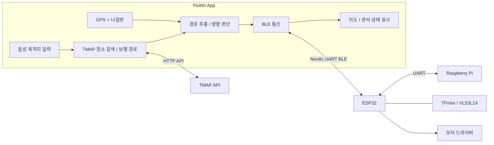

# Flutter App

스마트 지팡이의 **보행 경로 안내, 음성 목적지 입력, ESP32 BLE 통신 및 센서 상태 표시**를 담당하는 Flutter 앱입니다.

## System Architecture



## Main Features

- **음성 목적지 검색:** 한국어 STT로 목적지를 입력하고 TMAP 보행 경로를 조회합니다.
- **보행 방향 안내:** GPS 경로와 스마트폰 나침반을 비교해 `F/L/R` 방향 명령을 생성합니다.
- **BLE 연동:** `SMART_CANE` 장치에 자동 연결하고 방향 명령을 전송합니다.
- **실시간 상태 표시:** 지도, 목적지 거리, 정면·좌·우 센서 거리, 장애물 회피 및 횡단보도·신호등 상태를 표시합니다.
- **제어 우선순위:** 장애물 회피 또는 횡단보도 제어 중에는 일반 내비게이션 방향 명령을 보내지 않습니다.

## Communication

| 구분 | 방식 | 주요 데이터 |
| --- | --- | --- |
| Flutter ↔ TMAP | HTTPS | 장소 검색, 보행 경로 |
| Flutter ↔ ESP32 | BLE (Nordic UART Service) | `F/L/R:각도`, `B:방위각`, `S:0` |
| ESP32 → Flutter | BLE Notify | `DIST`, `SIDE`, `OBSTACLE`, `AVOID`, `CROSSWALK`, `LIGHT`, `CROSS_MOTOR` |

## Run

TMAP API 키는 코드에 직접 저장하지 않고 실행 시 전달합니다.

```bash
flutter pub get
flutter run --dart-define=TMAP_APP_KEY=YOUR_TMAP_APP_KEY
```

> 실제 보행 경로 안내에는 위치 권한, 인터넷 연결, TMAP API 키가 필요합니다. BLE 연동에는 ESP32의 `SMART_CANE` 광고 및 Nordic UART Service 구성이 필요합니다.
