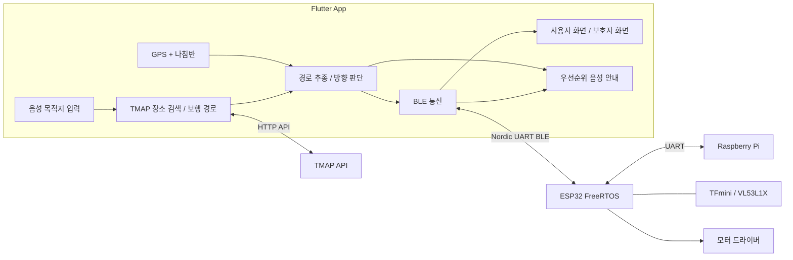
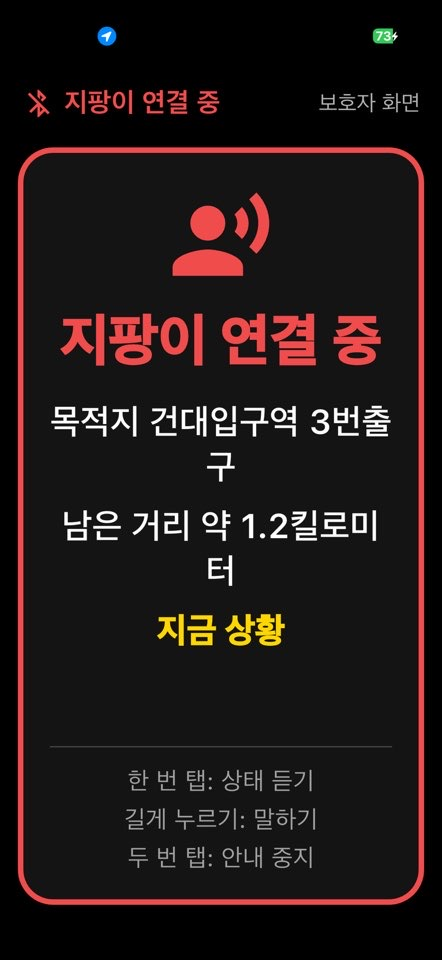
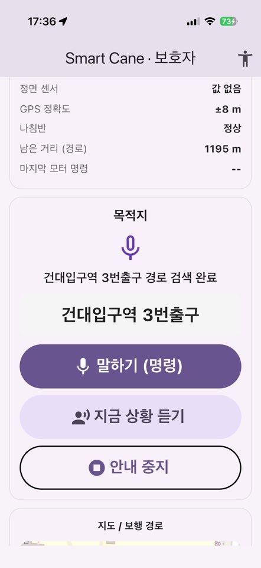
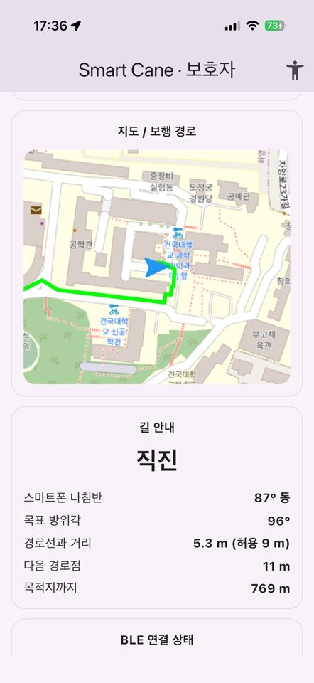

# Flutter App

스마트 지팡이의 **보행 경로 안내, 음성 목적지 입력, ESP32 BLE 통신 및 센서 상태 표시**를 담당하는 Flutter 앱입니다.

## System Architecture



## Main Features

- **음성 목적지 검색:** 한국어 STT로 목적지를 입력하고 TMAP 보행 경로를 조회합니다.
- **보행 방향 안내:** GPS 경로와 스마트폰 나침반을 비교해 `F/L/R` 방향 명령을 생성합니다.
- **BLE 연동:** `SMART_CANE` 장치에 자동 연결하고 방향 명령을 전송합니다.
- **실시간 상태 표시:** 지도, 목적지 거리, 정면·좌·우 센서 거리, 장애물 회피, 횡단보도·신호등 상태를 표시합니다.
- **제어 우선순위:** 장애물 회피나 횡단보도 제어 중에는 일반 내비게이션 방향 명령을 보내지 않습니다.

## Advanced UI 변경 사항

### 안전 로직

- **우선순위 음성 큐:** 위험 안내(장애물, 신호, 연결 끊김)가 일반 안내(남은 거리 등)를 끊고 먼저 나옵니다. 오래된 안내는 버립니다.
- **정면 센서 확인:** 정면 센서 값이 없거나 끊기면 방향 명령을 막고 "천천히"라고 안내합니다.
- **GPS / 나침반 신선도 검사:** 다음 경우에는 방향 안내를 멈추고 알립니다.
  - GPS가 5초 넘게 갱신되지 않음
  - GPS 정확도가 20m보다 나쁨
  - 나침반이 1.5초 넘게 갱신되지 않음
- **GPS 튐 보정:** 경로상 진행 위치가 실제 이동 거리보다 크게 바뀌거나 걷는 방향과 반대면 무시합니다. 같은 위치가 3번 연속 나와야 반영합니다.
- **도착 판정 강화:** 아래 조건이 2초 동안 이어져야 도착으로 봅니다.
  - 목적지 직선거리 10m 이내
  - 경로상 남은 거리 15m 이내
  - GPS 정확도 15m 이내
  - 횡단 중이 아님
- **BLE 전송 확인:** 전송 성공 여부를 확인합니다. 정지 명령은 실패하면 최대 3번 다시 보냅니다.
- **재연결 시 상태 복구:** 다시 연결되면 `Q`로 지팡이 상태를 요청하고, `ST:` 응답으로 장애물·횡단 상태를 다시 맞춥니다.
- **횡단 중 빨간불:** 건너는 중에 빨간불이 되어도 "정지"라고 하지 않고 끝까지 건너도록 안내합니다. 횡단이 끝난 뒤 3초 동안은 신호 안내를 미룹니다.

### 사용자 화면 (시각장애인용)

<p>
  
  
</p>

버튼 없이 화면 어디를 눌러도 됩니다.

| 동작 | 기능 | 진동 |
| --- | --- | --- |
| 한 번 탭 | 지금 상황 듣기 | 약하게 |
| 길게 누르기 (0.8초) | 말하기 (목적지 / 명령) | 중간 |
| 두 번 탭 | 길 안내 중지 | 강하게 |

- 검은 배경에 큰 글자를 쓰고, 상태에 따라 카드 테두리 색이 바뀝니다. (연결 끊김 빨강, 안내 중 파랑, 횡단 중 보라)
- 앱을 켜면 사용법을 한 번 말해 줍니다. "사용법" / "도움말"이라고 말해도 다시 알려 줍니다.
- 길게 누르기는 주머니 속 오작동을 줄이려고 0.8초로 했습니다.
- 스크린리더(TalkBack / VoiceOver)를 켜면 아래처럼 동작합니다. 이 앱은 스스로 말하므로 스크린리더를 끄고 쓰는 것을 권장합니다.
  - 두 번 탭: 상황 듣기
  - 동작 메뉴: 말하기 / 안내 중지 / 사용법

### 보호자 화면

<p>
  
  
</p>

- 기존 화면(지도, 경로, 센서 값, 라즈베리파이 인식 결과)을 보여 줍니다.
- 맨 위에 **안전 상태 요약**이 있습니다. (연결, 정면 센서, GPS 정확도, 나침반, 남은 거리, 마지막 모터 명령)
- 사용자 화면 오른쪽 위 `보호자 화면` 버튼으로 들어가고, 오른쪽 위 아이콘으로 돌아갑니다.

## Communication

| 구분 | 방식 | 주요 데이터 |
| --- | --- | --- |
| Flutter ↔ TMAP | HTTPS | 장소 검색, 보행 경로 |
| Flutter → ESP32 | BLE (Nordic UART Service) | `F/L/R:각도`, `B:방위각`, `S:0`, `Q` (상태 요청, Advanced UI) |
| ESP32 → Flutter | BLE Notify | `DIST`, `SIDE`, `OBSTACLE`, `AVOID`, `CROSSWALK`, `LIGHT`, `CROSS_MOTOR`, `ST:abcdefg` (상태 응답, Advanced UI) |

`ST:abcdefg`는 `Q`에 대한 응답이며, 글자 7개가 각각 아래 상태를 뜻합니다.

| 자리 | 의미 |
| --- | --- |
| a | 장애물 |
| b | 회피 방향 |
| c | 횡단보도 |
| d | 신호 |
| e | 횡단 중 |
| f | 정면 센서 끊김 |
| g | 동작 잠금 |

## Run

TMAP API 키는 코드에 직접 저장하지 않고 실행할 때 전달합니다.

```bash
flutter pub get

# 기본 UI
flutter run --dart-define=TMAP_APP_KEY=YOUR_TMAP_APP_KEY

# Advanced UI
flutter run -t advancedui/main.dart --dart-define=TMAP_APP_KEY=YOUR_TMAP_APP_KEY
```

> 실제 보행 경로 안내에는 위치 권한, 인터넷 연결, TMAP API 키가 필요합니다. BLE 연동에는 ESP32의 `SMART_CANE` 광고와 Nordic UART Service 구성이 필요합니다. 음성 입력에는 마이크 권한이 필요합니다.
>
> Advanced UI의 `Q` / `ST:` 상태 복구는 RTOS 펌웨어(`esp32/navis_esp32_rtos`)와 함께 써야 동작합니다.
