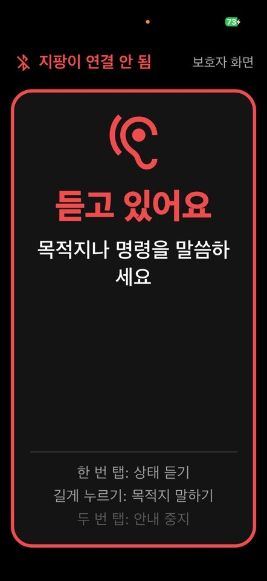
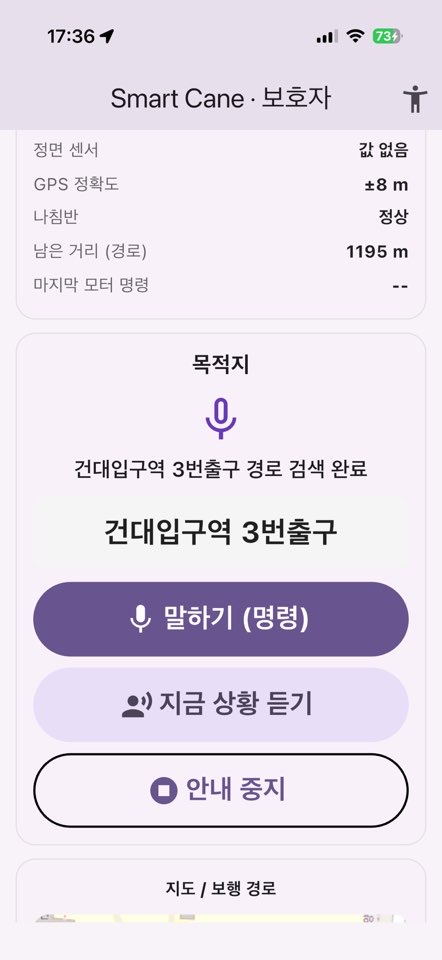
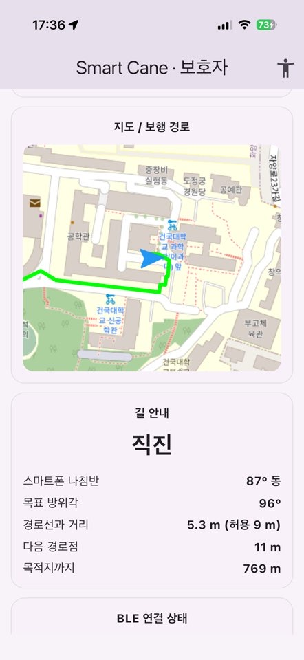

# NAVIS Smart Cane App

시각장애인용 스마트 지팡이(ESP32)와 블루투스로 연결해 음성으로 길을 안내하는 Flutter 앱입니다.

## 주요 기능

- **음성 길 안내**: 목적지를 말하면 경로를 찾아 남은 거리와 방향을 음성으로 알려 줍니다.
- **지팡이 연동 (BLE)**: ESP32 지팡이에 방향 명령을 보내 모터 진동으로 길을 알려 줍니다. 연결이 끊기면 다시 연결하고, 지팡이 상태를 다시 받아 옵니다.
- **장애물 안내**: 지팡이 센서가 장애물을 감지하면 바로 "멈추세요"라고 말하고, 피할 방향(왼쪽·오른쪽)을 알려 줍니다.
- **횡단보도 안내**: 신호등(라즈베리파이 인식)에 따라 정지·건너기를 안내합니다. 건너는 중에 빨간불이 되면 멈추라고 하지 않고 끝까지 건너도록 안내합니다.
- **안전 장치**
  - GPS와 나침반 값이 오래되었거나 부정확하면 안내를 잠시 멈추고 알려 줍니다.
  - GPS 위치가 갑자기 튀면 걸러 냅니다.
  - 도착은 여러 조건이 2초 동안 이어질 때만 확인합니다.
- **우선순위 음성**: 위험 안내(장애물, 신호)가 일반 안내보다 먼저 나옵니다.

## 화면

### 사용자 화면 (시각장애인용)

  
  

버튼 없이 화면 어디를 눌러도 됩니다.

| 동작 | 기능 |
|---|---|
| 한 번 탭 | 지금 상황 듣기 |
| 길게 누르기 (0.8초) | 말하기 (목적지 / 명령) |
| 두 번 탭 | 길 안내 중지 |

- 검은 배경에 큰 글자를 쓰고, 상태에 따라 테두리 색이 바뀝니다.
- 동작마다 진동 세기가 다릅니다.
- "사용법"이라고 말하면 사용법을 다시 알려 줍니다.

### 보호자 화면

  
  

- 지도와 보행 경로를 보여 줍니다.
- 길 안내 정보(나침반, 목표 방위각, 경로선과 거리, 남은 거리)를 보여 줍니다.
- 지팡이 연결 상태와 안전 상태 요약을 보여 줍니다.
- 사용자 화면 오른쪽 위 `보호자 화면` 버튼으로 들어갑니다.

## 실행 방법

    cd flutter_app
    flutter pub get
    flutter run

> 실제 폰에서 실행해야 합니다. 블루투스, GPS, 마이크 권한이 필요합니다.

## 구성

- `flutter_app/` : Flutter 앱 (`lib/main.dart`)
- `esp32/` : 지팡이 펌웨어 (FreeRTOS)
- `raspberry_pi/` : 신호등 인식
- `docs/` : 앱 화면 / 하드웨어 사진
