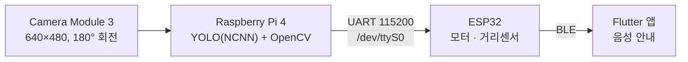
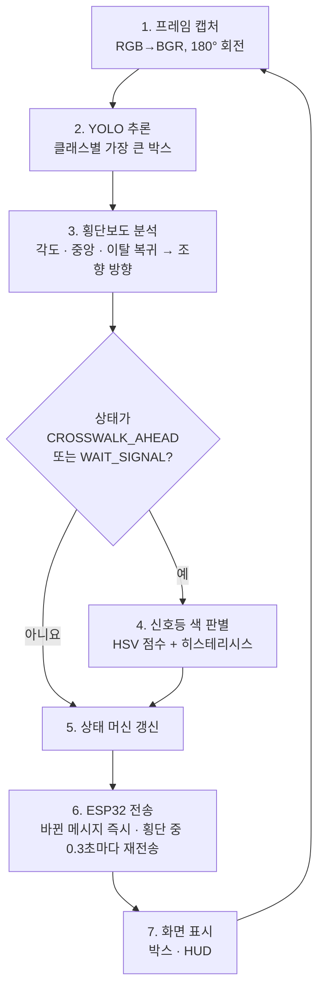
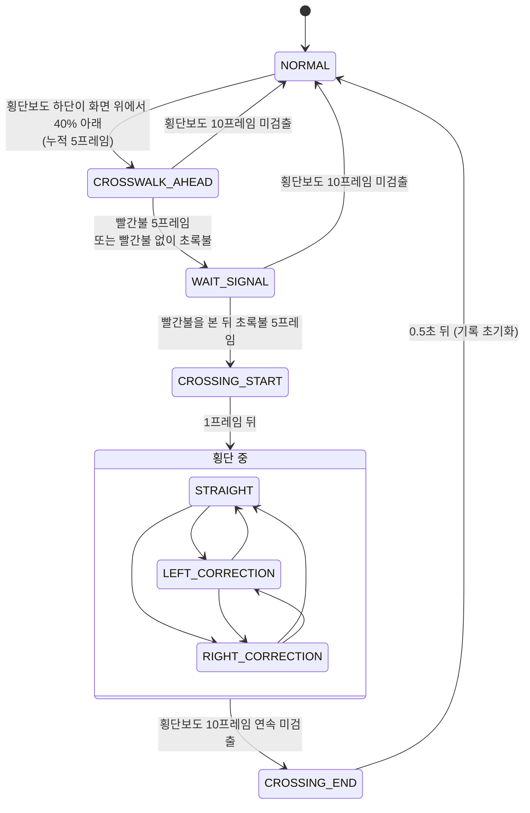
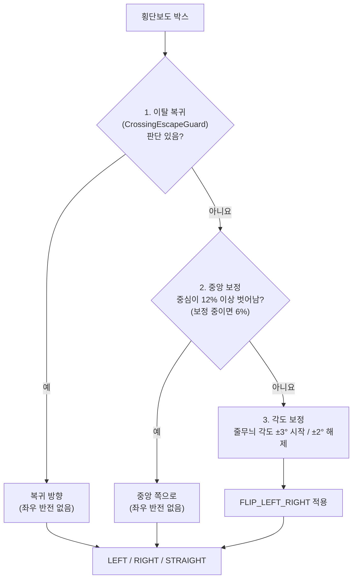
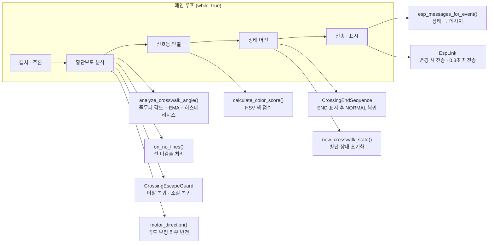

# Raspberry Pi

Camera Module 3 영상으로 **횡단보도·신호등을 인식**하고, 횡단 상태와 조향 방향을 **UART로 ESP32에 전송**하는 Raspberry Pi 4 코드입니다.

## 전체 구성

## 인식 대상

YOLO(NCNN) 모델 `best4_ncnn_model`로 `cross-walk`, `traffic_light`, `ground_light`를 검출하고, 클래스별로 **가장 큰 박스 하나만** 사용합니다.

## 프레임 처리 순서

추론 루프 한 바퀴(= 1프레임)마다 아래 순서로 처리합니다.

## 상태 흐름

| 상태 | 진입 조건 | 전송 메시지 |
|---|---|---|
| `NORMAL` | 시작 / 종료 0.5초 후 / 횡단 전 횡단보도 10프레임 미검출 | `CROSSWALK:0` |
| `CROSSWALK_AHEAD` | 횡단보도 박스 하단이 화면 위에서 40% 지점보다 아래 (누적 5프레임, 벗어나면 1씩 감소) | `CROSSWALK:1` |
| `WAIT_SIGNAL` | 빨간불 5프레임 / 빨간불을 못 보고 초록불부터 보면 대기 | `LIGHT:RED` / `LIGHT:GREEN_WAIT` |
| `CROSSING_START` | 빨간불을 본 뒤 초록불 5프레임 (1프레임만 유지 후 `STRAIGHT`) | `LIGHT:GREEN`, `CROSSING_START` |
| 횡단 보정 | 횡단 중 매 프레임 | `CROSS_MOTOR:CENTER` / `L` / `R` (0.3초마다 재전송) |
| `CROSSING_END` | 횡단보도 10프레임 연속 미검출 | `CROSSING_END` |

- 프레임 수는 카메라 FPS가 아니라 **추론 루프 기준**입니다. (Pi 4에서 약 2~3 FPS)
- 메시지는 **바뀔 때만** 보내고, 횡단 중(`STRAIGHT` / `LEFT_CORRECTION` / `RIGHT_CORRECTION`)에만 같은 메시지를 0.3초마다 다시 보냅니다. ESP32는 1초 동안 메시지가 없으면 조향을 멈춥니다.
- `NORMAL`로 돌아오면 신호 기록(빨간불을 봤는지)과 횡단 상태를 모두 초기화하고, 다음 횡단보도를 처음부터 판단합니다.

## 횡단 중 조향 우선순위

횡단보도 박스가 보이는 동안 매 프레임 아래 순서로 **먼저 해당하는 하나**를 씁니다.

1. **이탈 복귀** (`CrossingEscapeGuard`)
   - 초록불 이후 박스 폭이 화면의 **60% 이상인 프레임을 2번 연속** 본 뒤에만 활성화됩니다. (HUD `ESC` 점: 초록 = 활성)
   - 박스 폭이 **35% 이하**로 줄고 중심이 한쪽으로 **12% 넘게** 치우친 상태가 **2프레임** 이어지면 그쪽으로 복귀합니다. 확인하는 동안에는 직진입니다.
   - 폭이 **50% 이상**으로 돌아오거나 중심이 **6% 안**으로 들어온 상태가 2프레임 이어지면 복귀를 끝냅니다. 횡단보도가 반대쪽으로 옮겨 가면 기존 복귀를 바로 버립니다.
   - **박스가 사라졌을 때**: 2프레임 연속 미검출이고, 사라지기 직전 2프레임에서 폭이 8%p 이상 줄면서 같은 쪽으로 8% 이상 이동했으면(마지막 검출이 2초 이내), 그 방향으로 **최대 0.6초 또는 2프레임**만 복귀하고 이후 직진합니다. 근거가 없으면 직진합니다.
2. **중앙 보정**: 박스 중심이 화면 중심에서 **12%** 이상 벗어나면, **6%** 안으로 들어올 때까지 중앙 쪽으로 보정합니다.
3. **각도 보정**: Canny + HoughLinesP로 줄무늬 각도를 구합니다(길이 30px 이상, ±45° 안의 선만, 5° 단위로 묶어 가장 많은 묶음의 길이 가중 평균). EMA(α = 0.2)로 평활화한 뒤 **±3°를** 넘으면 보정을 시작하고 **±2°** 안으로 들어오면 직진합니다. 줄무늬가 **2프레임** 동안 안 보이면 직진합니다.

`FLIP_LEFT_RIGHT`는 **각도 보정에만** 좌우 반전을 적용합니다. 실제 조향 방향이 반대라면 `False`로 바꿉니다.

## 신호등 색 판별

- `CROSSWALK_AHEAD` / `WAIT_SIGNAL` 상태에서만 판별합니다.
- 신호등 박스(없으면 바닥 신호등 박스) 안에서 HSV 빨강/초록 마스크를 만들고, 색 픽셀 비율이 3%를 넘으면 `점수 = (0.4 × 비율 + 0.3 × 채도 + 0.3 × 명도) × 1.5`로 계산합니다.
- 점수가 **0.18 이상**이고 다른 색보다 높은 색을 택합니다.
- 처음 본 색은 바로 채택하고, 이후 다른 색으로 **바뀌려면 5프레임** 연속 확인이 필요합니다. (같은 색이 보이면 후보 카운트가 1씩 줄어듦)
- 신호등이 **10프레임** 동안 보이지 않으면 `Unknown`으로 초기화합니다.

## 코드 구성

| 이름 | 역할 |
|---|---|
| `analyze_crosswalk_angle()` | 횡단보도 ROI에서 줄무늬 각도를 구하고 EMA·히스테리시스로 방향과 신뢰도를 반환 |
| `on_no_lines()` | 줄무늬가 안 보일 때 처리. 2프레임 이상이면 각도 추적을 초기화하고 직진 |
| `new_crosswalk_state()` | 각도 추적 상태(EMA, 방향, 중앙 보정 여부, 미검출 수) 초기화 |
| `CrossingEscapeGuard` | 횡단 중 횡단보도 밖으로 벗어날 때의 복귀 조향과, 박스가 사라졌을 때의 짧은 복귀 |
| `motor_direction()` | `FLIP_LEFT_RIGHT`에 따라 각도 보정 방향만 좌우 반전 |
| `calculate_color_score()` | 신호등 ROI의 빨강/초록 점수 계산 |
| `CrossingEndSequence` | 미검출 10프레임이면 `CROSSING_END`를 0.5초 표시한 뒤 `NORMAL` 반환 |
| `esp_messages_for_event()` | 내부 상태를 ESP32/앱 공통 메시지로 변환 |
| `EspLink` | 메시지가 바뀌면 바로, 횡단 중에는 0.3초마다 같은 메시지를 다시 전송 |

## 화면 표시 (HUD)

| 줄 | 내용 |
|---|---|
| 1 | FPS, 현재 상태 |
| 2 | 확정된 신호 색 |
| 3 | 바뀌는 중인 후보 색과 확인 횟수 (n/5) |
| 4 | 신호등 미검출 수 (n/10), 빨간불을 봤는지 |
| 5 | 횡단보도 폭 비율(W), 줄무늬 미검출 수(N), 조향 근거, `ESC` 점 |

조향 근거: `ANGLE`(각도) · `NO_LINE`(줄무늬 잠시 안 보임) · `CENTER`(중앙 보정) · `RECOVER`(이탈 복귀) · `CHECK`(복귀 확인 중) · `LOST_REC`(소실 복귀) · `NO_BOX`(박스 없음)

창을 클릭한 뒤 `q`를 누르면 종료합니다.

## 설정

| 항목 | 값 |
|---|---|
| UART 포트 | `/dev/ttyS0`, 115200 bps (`raspi-config`에서 Serial Port 하드웨어 사용, 로그인 셸 끄기) |
| 카메라 | 640×480, 180° 회전 |
| 모델 | `best4_ncnn_model` (실행 위치에 있어야 함) |
| 필요 패키지 | `picamera2`, `opencv`, `ultralytics`, `ncnn`, `pyserial` |
| 튜닝 값 | 코드 상단 상수 |

메시지 전체 목록과 실행 방법은 [루트 README](../README.md)를 참고하세요.
